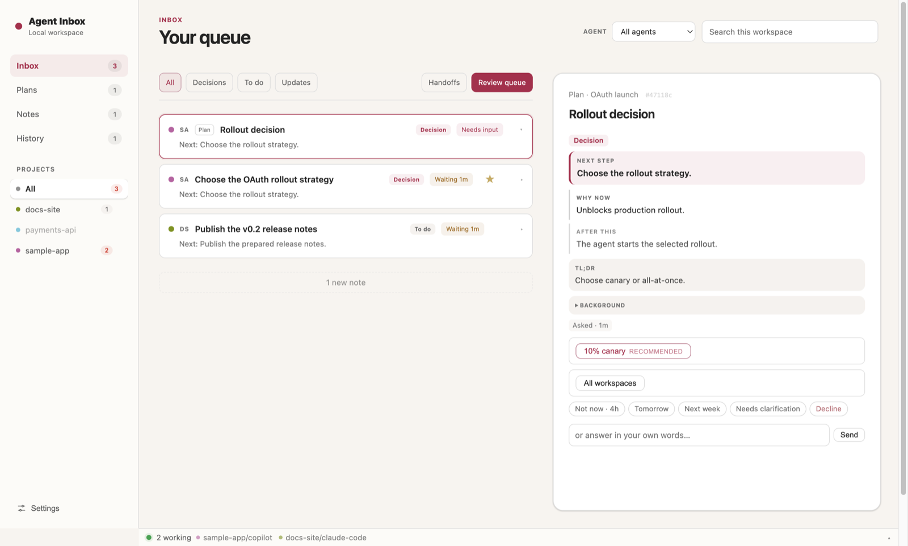

# Agent Inbox

From https://github.com/shariqh/agent-inbox. Screenshots come from its README.

The idea to look at is a queue of things that need you, across every project, that you answer without opening the session.

- Each card is a question or handoff from an agent, with the project, how long it has waited, and the next step.
- The detail pane on the right says why it matters now and what happens after you answer.
- You answer with a recommended option, free text, or a snooze ("Not now · 4h", "Tomorrow").
- A bottom bar shows which agents are working, without turning that into alerts.

For Tau, this could be a home view: open Tau and see what is waiting, answer quick questions in place, and open the full session only when needed.
