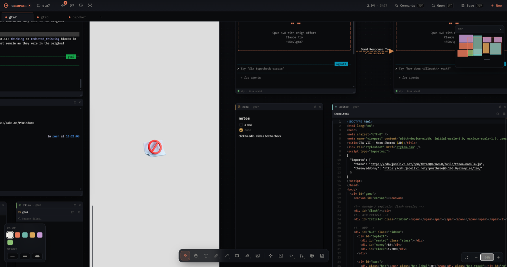

# ccanvas

From https://github.com/DevoidSloth/ccanvas. Screenshots come from its README.

The idea to look at is space instead of tabs: agents, terminals, files, diffs, and notes are boxes on a zoomable canvas.

- A roster lists every agent across canvases, with status and its last line, and clicking one flies to it.
- "Track this agent" opens each file the agent touches around it, with arrows back to the agent.
- Arrows between agents can pass one agent's result to the next.

Too heavy for a phone, but the tracked files around an agent are a fresh way to show what a session touched.
