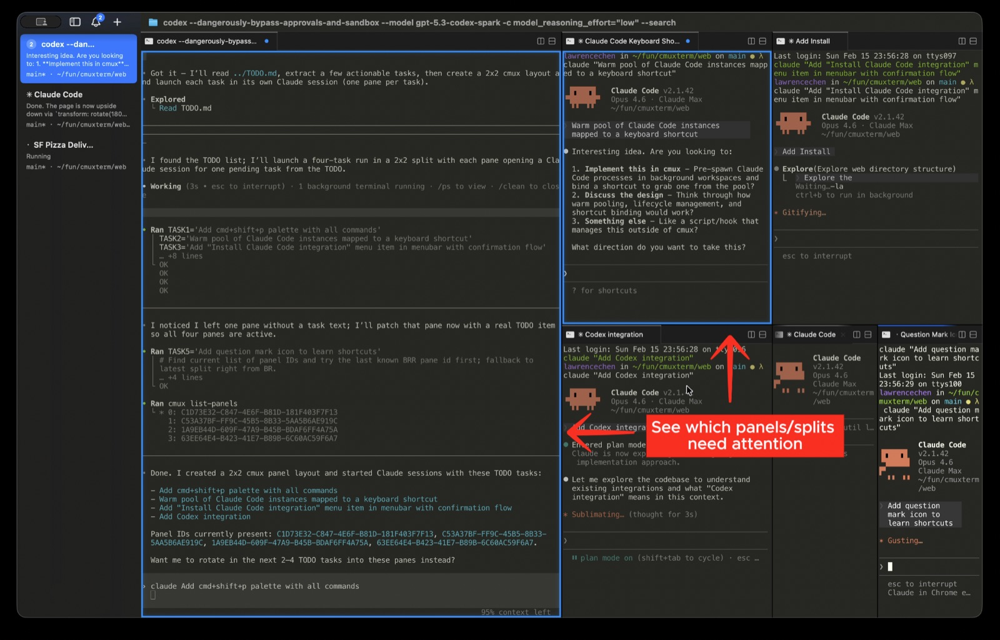

# cmux

From https://github.com/manaflow-ai/cmux. Screenshots come from its README.

The idea to look at is attention shown on the thing that needs you, not only in a list.

- A pane with a waiting agent gets a blue ring, and its tab lights up in the sidebar.
- Each sidebar entry shows branch, folder, ports, and the agent's latest message.
- One shortcut jumps to the most recent unread, and a popover lists all pending ones.

For Tau, a "next waiting" shortcut and the latest message under each session would make jumping between agents faster.
