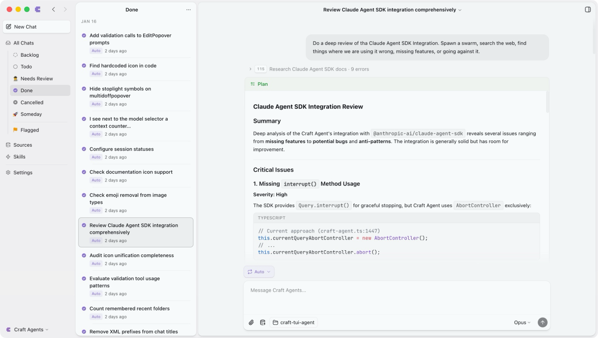

# Craft Agents

From https://github.com/craft-ai-agents/craft-agents-oss. Screenshots come from its README.

The idea to look at is sessions managed like mail: three columns of navigation, status filter, and session list, beside the conversation.

- Sessions have a status you set (Backlog, Todo, Needs Review, Done, Someday) and can be flagged.
- The left column picks a status, and the middle column lists those sessions.
- The project folder shows as a chip under the prompt, not as a place you navigate to.

For Tau, a "Needs review" status you set yourself would separate finished-but-unchecked work from done work.
