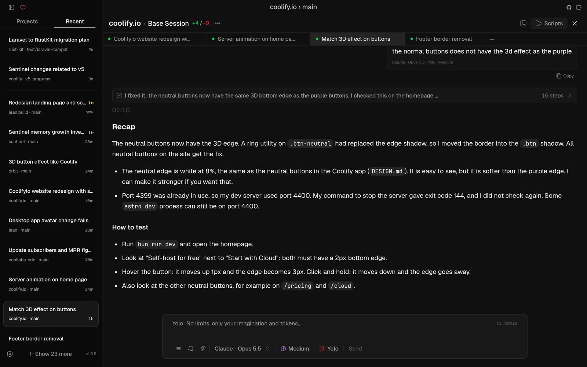
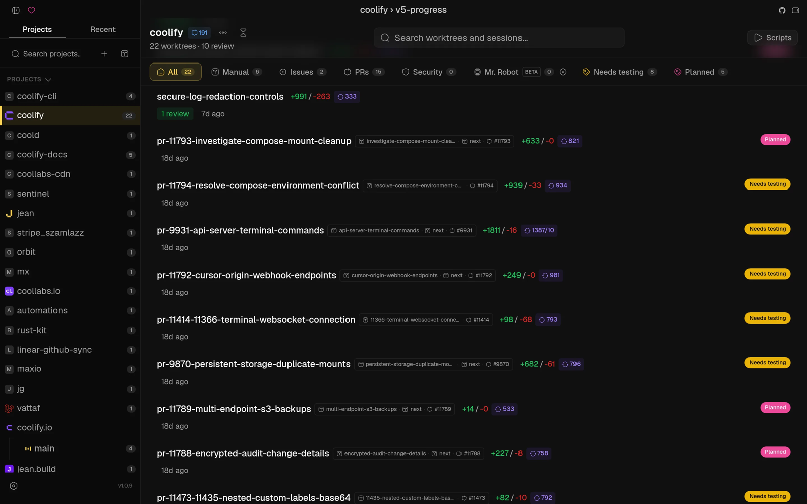

# Jean

From https://github.com/coollabsio/jean. Screenshots come from its README.

The idea to look at is two ways into the same sessions: a flat Recent list across projects, and a Projects list that leads to a page per project.

- `recent-sessions.png`: the Recent tab lists sessions from all projects by time, with project and branch under each title. Sessions of the open worktree also show as tabs above the transcript.
- `project-worktrees.png`: a project page lists its worktrees with diff size, PR, and a status label (Planned, Needs testing), filtered by Issues, PRs, and more.

For Bica, the Recent and Projects tabs on the left keep fast switching between sessions while still giving each project a home.

