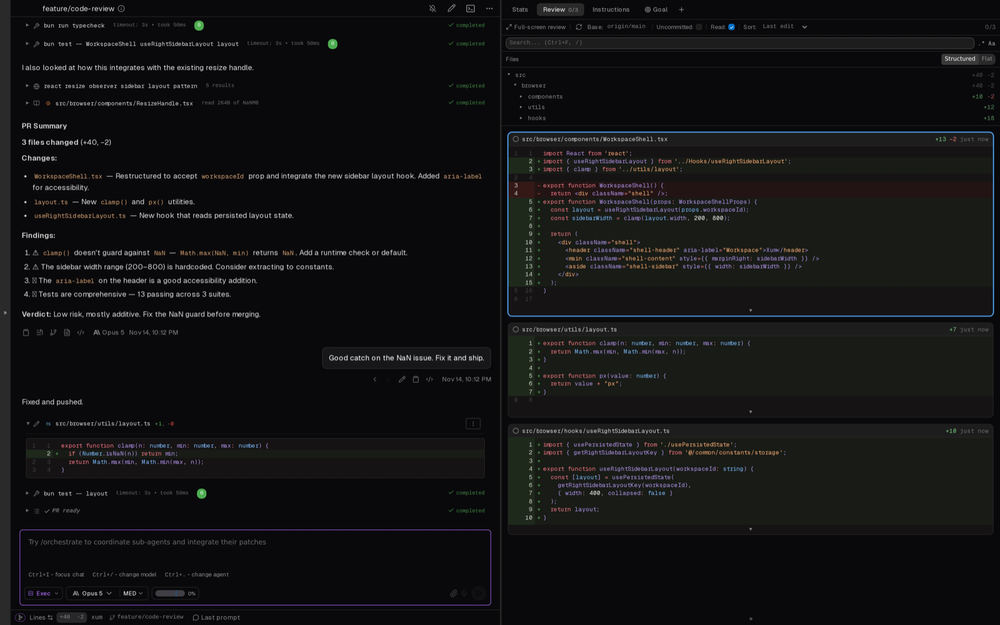

# Mux

From https://github.com/coder/mux. Screenshots come from its README.

The idea to look at is review as a full half of the screen, next to the chat that produced it.

- The right side has its own tabs: Stats, Review, Instructions, Goal.
- Review shows a file tree and then every changed file stacked, each marked read or not, with a "0/3" counter.
- A "Full-screen review" button and a base picker (`origin/main`, uncommitted) sit above the files.

For Tau, the read counter and stacked files make reviewing a whole change one scroll instead of one file at a time.
