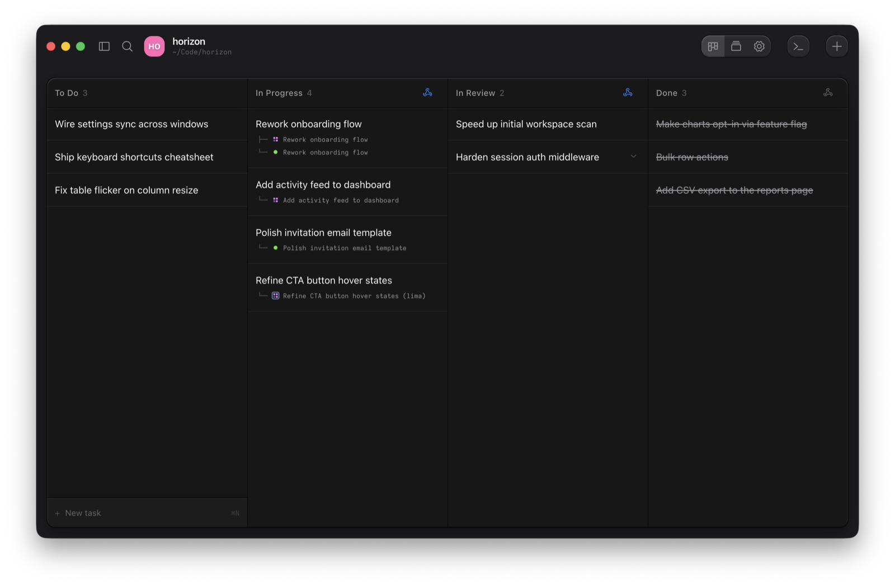
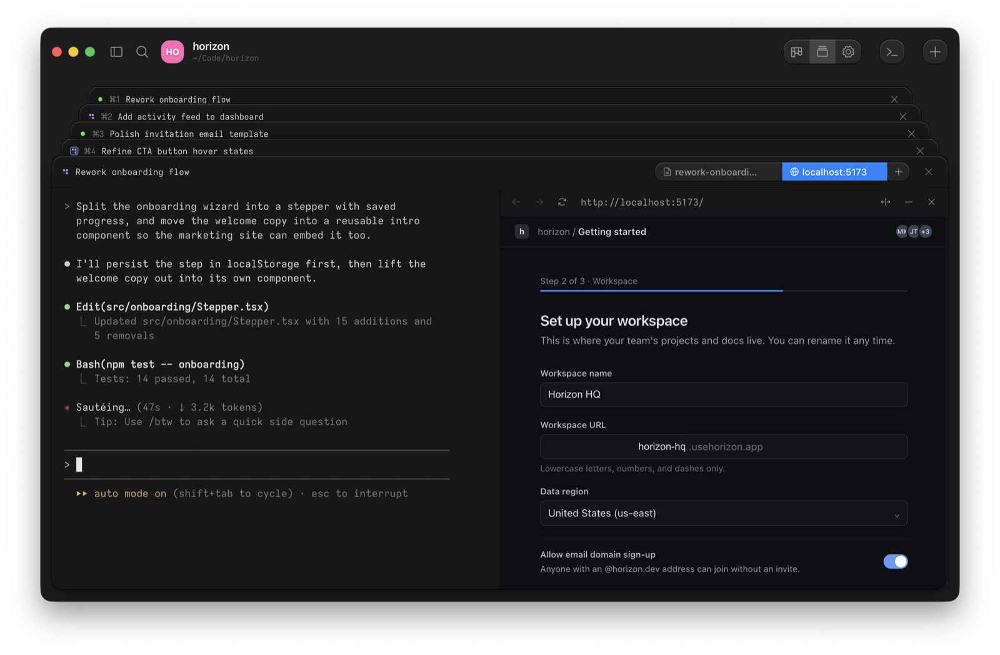

# Ouijit

From https://github.com/ouijit/ouijit. Screenshots come from its README.

The idea to look at is one project shown two ways: a task board, or a stack of task terminals.

- `task-board.png`: To Do, In Progress, In Review, and Done. Moving a card starts its worktree and agent. Running terminals show under their task.
- `terminal-stack-preview.png`: the open tasks stack like cards, with `⌘1` to `⌘4` to switch. A browser preview or a markdown plan attaches as a tab beside the agent.

For Bica, the stack is a compact way to keep several sessions of one project close, and the attached tabs keep the preview next to the agent that changes it.

