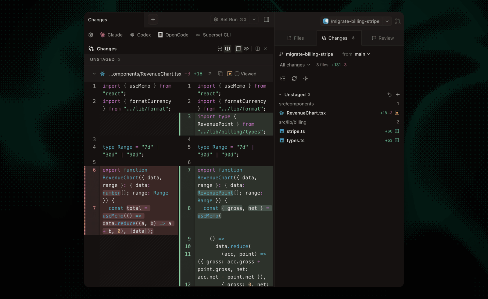

# Superset

From https://github.com/superset-sh/superset. Screenshots come from its README.

The idea to look at is a changes list that stays on the right while the diff fills the center.

- The right panel has Files, Changes, and Review tabs, with the branch and its base at the top.
- Each file has a "Viewed" checkbox, and changes are grouped by folder.
- Agents (Claude, Codex, OpenCode) are tabs in the same strip as the changes.

This is close to Bica's project page today, so it is mostly a check on details like the viewed checkbox.
